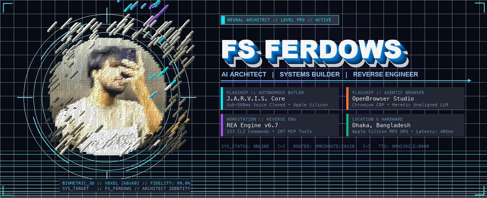

<div align="center">

<!-- 3D IMMERSIVE HOLOGRAPHIC VOXEL AVATAR & TYPOGRAPHY HERO -->
<a href="https://github.com/fsferdows">
  
</a>

<br/>

<!-- INTERACTIVE DYNAMIC TYPING SVG STREAM -->
<a href="https://github.com/fsferdows">
  
</a>

<p align="center">
  <a href="https://www.fsferdows.com"></a>
  <a href="https://linkedin.com/in/fs-ferdows-536828388"></a>
  <a href="https://youtube.com/@fsferdowsyt"></a>
  <a href="https://instagram.com/fsferdows"></a>
  <a href="mailto:ferdowsrahman1@gmail.com"></a>
</p>

</div>

---

### 📡 Holographic Telemetry & Systems Status

```yaml
SYS_IDENTITY:
  Architect: "FS FERDOWS"
  Role: "Lead AI Architect & Distributed Systems Engineer"
  Base: "Dhaka, Bangladesh [23.8103° N, 90.4125° E] · UTC+6"
  Organization: "LateBright Engineering"

ACTIVE_RUNTIMES:
  Neural_Speech_Synthesis: "OmniVoice MPS Diffusion (405ms Verified)"
  Autonomous_Model_Router: "OmniRoute (350+ Provider Swarm on Port 20128)"
  Agentic_Browser_Core:    "Chromium CDP Duplex Engine (OpenBrowser:3000)"
  Reverse_Engineering:     "REA Engine v6.7 (153 CLI Commands · 207 MCP Tools)"
  Execution_Security:      "Safe Sandbox with Opt-in Real-World OS Writes"
```

---

## 🏆 GitHub 3D Trophy Showcase & Verified Achievements

<div align="center">
  <a href="https://github.com/fsferdows">
    
  </a>
</div>

---

## ⚡ Profile Highlights & Industry Credentials

<div align="center">

| Highlight | Domain & Role | Status |
| :--- | :--- | :---: |
| ⚡ **J.A.R.V.I.S. Architect** | Creator & Lead AI Architect of real-life Iron Man JARVIS (OmniVoice + OmniRoute) | `FLAGSHIP` |
| 🦁 **OpenBrowser Architect** | Creator & Lead Maintainer of OpenBrowser: autonomous AI browser with Chromium CDP | `PRODUCTION` |
| ⭐ **GitHub Pro Verified** | Developer tier with advanced developer tooling, verified pro badge & private repo CI | `ACTIVE` |
| 🧠 **Autonomous AI Systems** | Specialized in unaligned intelligence, self-healing selectors & multi-agent swarms | `SPECIALIST` |
| 🛠️ **Reverse Engineering** | REA Engine expert: binary decompilation, AST transformation & protocol inspection | `SECOPS` |
| 🏢 **Engineering at LateBright** | Crafting high-performance distributed systems, state-of-the-art UI/UX & web apps | `TECH LEAD` |
| 📍 **Dhaka, Bangladesh** | Engineering global-grade open-source systems for hackers and researchers worldwide | `GLOBAL` |

</div>

---

## 🌟 Featured Flagship Systems

### ⚡ [J.A.R.V.I.S. — Real-Life Autonomous Iron Man Butler](https://github.com/fsferdows/Jarvis)

<a href="https://github.com/fsferdows/Jarvis">
  
</a>

> **Zero-Shot Cloned Voice (Sub-500ms on Apple Silicon MPS), OmniRoute 350+ Model Routing, and Real-World OS Control**
>
> A production-grade autonomous desktop butler inspired by Tony Stark's J.A.R.V.I.S. Featuring an interactive Three.js Arc Reactor HUD, zero-screenshot DOM vision, REA reverse engineering engine (153 commands), and native macOS automation.
>
> ⭐️ **[Explore J.A.R.V.I.S. on GitHub →](https://github.com/fsferdows/Jarvis)**

<br clear="both"/>

### 🦁 [OpenBrowser — Autonomous AI Agentic Browser](https://github.com/fsferdows/OpenBrowser)

<a href="https://github.com/fsferdows/OpenBrowser">
  
</a>

> **The Production-Grade Autonomous AI Agentic Browser for Hackers & Power Users**
>
> OpenBrowser reimagines web navigation by moving the entire autonomous browser workstation onto `localhost:3000`. Built with a duplex Chromium CDP engine, unaligned Heretic refusal-free intelligence, HackSuite pentesting tools, self-healing CSS selectors, and zero-cost LLM routing.
>
> ⭐️ **[Explore OpenBrowser on GitHub →](https://github.com/fsferdows/OpenBrowser)**

<br clear="both"/>

---

## ⚡ What I Do & Build

- 🧠 **Autonomous AI & Multi-Agent Swarms**: Designing autonomous decision engines, refusal-free reasoning frameworks, and goal trajectories that perceive, act, and self-heal in real time.
- 🌐 **Browser Engines & Reverse Engineering**: Deep integrations with Chromium DevTools Protocol (CDP), synthetic input relay, DOM AST synthesizers, and anti-fingerprinting shields.
- 🎨 **Design Engineering & High-Craft Interfaces**: Crafting state-of-the-art web architectures with micro-animations, glassmorphism, responsive ergonomics, and sub-100ms interaction latencies.
- 🛡️ **Cybersecurity & Recon Workstations**: Building automated HTTP repeaters, attack surface scanners, JWT decoders, and vulnerability audit suites.

---

## 🛠️ Curated Technology Arsenal

<div align="center">

### 🧠 AI & Autonomous Systems
<p>
  
  
  
  
  
  
  
</p>

### 💻 Core Systems & Architecture
<p>
  
  
  
  
  
  
</p>

### 🎨 Frontend Craft & Design Engineering
<p>
  
  
  
  
  
  
</p>

### ☁️ Cloud, Databases & DevOps
<p>
  
  
  
  
  
  
  
</p>

</div>

---

## 📈 Activity & Real-Time Insights

<div align="center">
  <p align="center">
    
    
  </p>
  
  <p align="center">
    
  </p>
</div>

---

## 💬 Connect with the Architect

Whether you're looking to collaborate on autonomous AI agents, explore reverse engineering architectures, or discuss cutting-edge browser telemetry:

- 🌐 **Portfolio & Case Studies**: [fsferdows.com](https://www.fsferdows.com)
- 💼 **LinkedIn**: [in/fs-ferdows-536828388](https://linkedin.com/in/fs-ferdows-536828388)
- 📺 **YouTube Channel**: [@fsferdowsyt](https://youtube.com/@fsferdowsyt)
- 📬 **Direct Email**: [ferdowsrahman1@gmail.com](mailto:ferdowsrahman1@gmail.com)

<div align="center">
  <br>
  <sub>⚡ Designed & Engineered with precision by <b>FS FERDOWS</b> • Dhaka, Bangladesh</sub>
</div>
